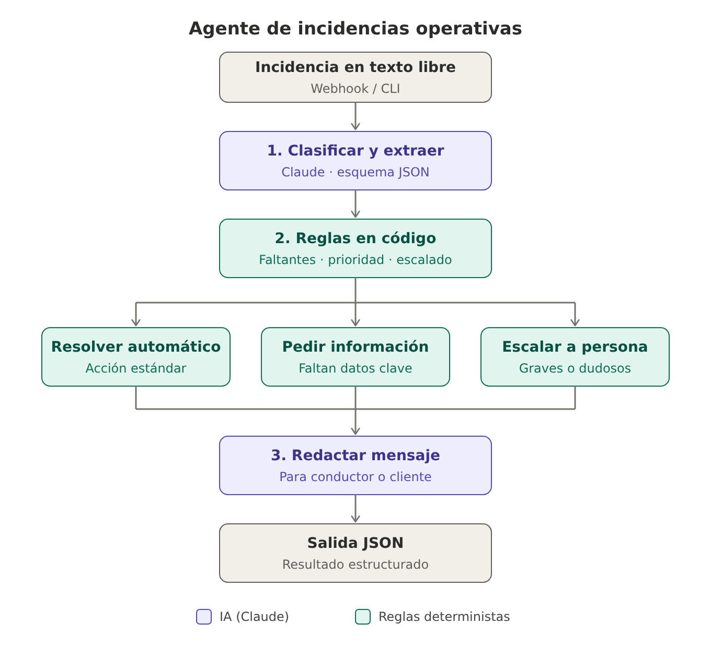
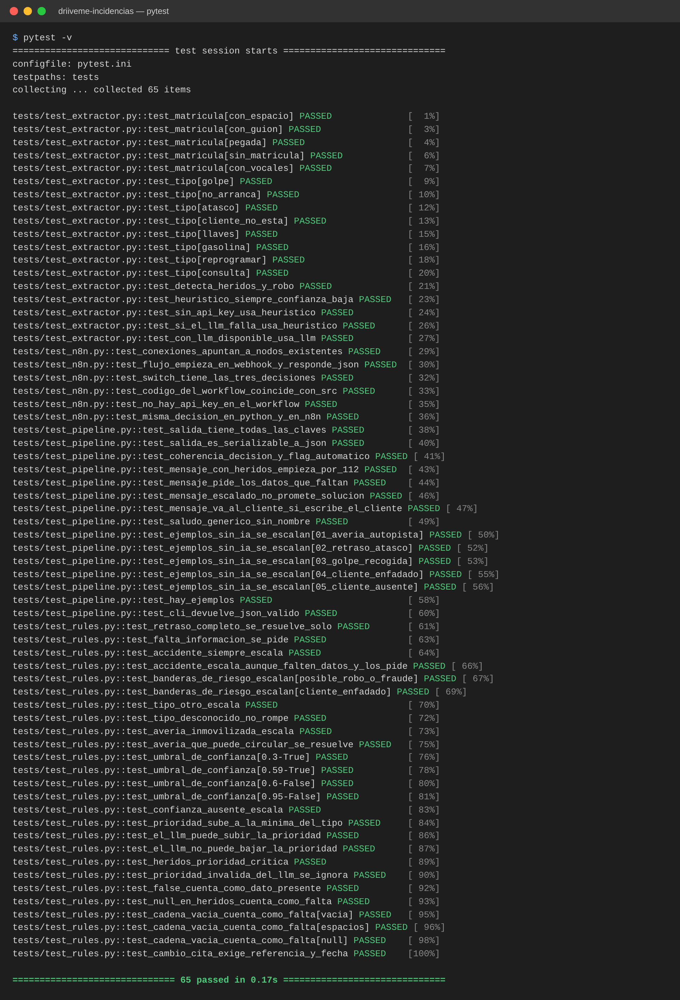

# Agente de incidencias operativas

Prototipo de agente que recibe una incidencia en texto libre sobre el movimiento de un vehículo y devuelve un resultado estructurado (JSON) con la clasificación, los datos extraídos, la información que falta, la siguiente acción, un mensaje para el conductor o el cliente y la decisión de resolverlo automáticamente o escalarlo a una persona.

Hay dos implementaciones de la misma lógica:

- **Python** (`agente/`): script de línea de comandos, con tests.
- **n8n** (`n8n/workflow_incidencias.json`): el mismo flujo como workflow importable, expuesto como webhook.

## Arquitectura



```
Incidencia (texto)
   │
   ▼
1. Clasificar y extraer  ──  Claude (tool use forzado → JSON con esquema fijo)
   │
   ▼
2. Reglas de negocio     ──  código determinista
   │   · campos obligatorios según el tipo → información que falta
   │   · prioridad mínima por tipo (el LLM puede subirla, no bajarla)
   │   · reglas de escalado (heridos, accidente, robo, vehículo inmovilizado,
   │     cliente enfadado, tipo desconocido, confianza < 0,6)
   │
   ├── resolver_automaticamente
   ├── solicitar_informacion
   └── escalar_a_persona
   │
   ▼
3. Redactar mensaje      ──  Claude (Python) o plantilla (n8n / sin API key)
   │
   ▼
Salida JSON
```

### Decisiones de diseño

- **El LLM interpreta, el código decide.** Claude se encarga de lo que requiere entender lenguaje: clasificar, extraer datos y redactar. Las decisiones con impacto operativo (qué falta, prioridad y escalado) están en reglas de código, que son predecibles, auditables y testeables. Así, un accidente se escala siempre, aunque el modelo se equivoque con la prioridad.
- **Salida estructurada garantizada.** Se usa *tool use* con `tool_choice` forzado y un esquema JSON. El modelo tiene que rellenar los campos definidos, y lo que no aparece en el texto se devuelve como `null` en lugar de inventarse.
- **`null` ≠ `false`.** Que no se mencionen heridos (`null`) no es lo mismo que confirmar que no los hay (`false`). En un accidente, un `null` hace que se pregunte.
- **El mensaje se redacta después de decidir**, para que sea coherente: no promete una solución si el caso se escala y pide exactamente los datos que faltan. Si hay heridos, lo primero que dice es que llamen al 112.
- **Fallo seguro.** Sin API key, o si la llamada al modelo falla, se usa un extractor heurístico (palabras clave y una expresión regular para la matrícula) con confianza 0,4. Las reglas escalan todo lo que tiene confianza baja, así que sin LLM todo pasa a una persona.

### Tipos de incidencia

`averia`, `accidente_danos`, `retraso`, `cliente_ausente`, `llaves_documentacion`, `combustible_carga`, `cambio_cita` y `otro`.

## Uso (Python)

```bash
pip install -r requirements.txt
export ANTHROPIC_API_KEY=sk-ant-...        # opcional: sin ella usa el modo heurístico
python main.py ejemplos/01_averia_autopista.txt
python main.py "El cliente no está en la entrega, matrícula 5512JNR"
python main.py --todos                      # procesa ejemplos/*.txt → ejemplos/salidas/
pytest -v                                   # 65 tests, no necesitan API key
```

El modelo se puede cambiar con la variable `CLAUDE_MODEL`.

## Tests

`pytest -v` ejecuta 65 tests que no llaman a la API (la extracción del LLM se simula):

- `test_rules.py`: información faltante, prioridad, umbral de confianza y reglas de escalado.
- `test_extractor.py`: extractor heurístico (matrículas, tipos) y fallback cuando el LLM falla.
- `test_pipeline.py`: estructura de la salida, mensajes (112 si hay heridos, pedir datos que faltan), ejemplos y CLI.
- `test_n8n.py`: estructura del workflow y **paridad**: las reglas en JavaScript de n8n dan exactamente la misma decisión que las de Python (requiere Node.js; si no está, ese test se omite).



## Uso (n8n)

1. En n8n: *Workflows → Import from file* → `n8n/workflow_incidencias.json`.
2. En el nodo **Claude: clasificar y extraer**, crea una credencial *Header Auth* con nombre `x-api-key` y tu API key como valor.
3. Activa el workflow y envía una incidencia:

```bash
curl -X POST http://localhost:5678/webhook/incidencia \
  -H "Content-Type: application/json" \
  -d '{"incidencia": "Soy Javier, el coche echa humo en la A-3 km 186, matrícula 4821LKP"}'
```

Las tres ramas del nodo *Según decisión* terminan en nodos de marcador de posición. En ellos se conectaría el envío real (SMS, WhatsApp o email), la creación del ticket o el aviso al equipo por Slack.

## Ejemplos de incidencias (`ejemplos/`)

| Fichero | Qué prueba |
|---|---|
| `01_averia_autopista` | Avería con todos los datos → vehículo inmovilizado → escalar |
| `02_retraso_atasco` | Retraso con nueva hora → resolver automáticamente (avisar al cliente) |
| `03_golpe_recogida` | Daños sin matrícula ni conductor → escalar y pedir datos |
| `04_cliente_enfadado` | Cliente que amenaza con reclamar → escalar |
| `05_cliente_ausente` | Cliente ausente con datos completos → resolver automáticamente |

## Qué mejoraría con más tiempo

- Conectarlo al sistema real de trayectos para validar la matrícula y la referencia, y completar automáticamente al conductor y al cliente.
- Histórico de la conversación, para que la respuesta del conductor con los datos que faltaban reabra la misma incidencia.
- Un conjunto de evaluación con incidencias reales etiquetadas para medir la precisión de la clasificación y ajustar el umbral de confianza.
- Métricas: porcentaje de resolución automática, tiempo hasta escalar y errores de clasificación.
- Reglas configurables (YAML o base de datos) en lugar de constantes en el código.
